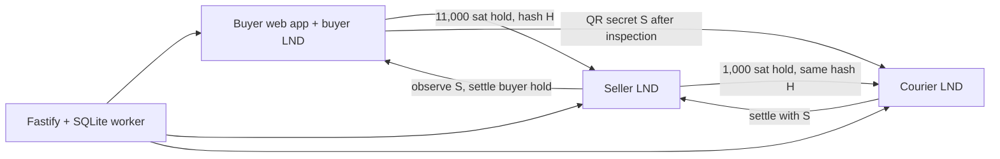

# FlashDrop — Dakar payment on delivery prototype

An English-language, regtest-only Lightning payment flow for a seller, buyer, and courier. The buyer holds the full price before dispatch, inspects the parcel, then authorizes release with a code. The seller's outgoing courier payment uses the same payment hash and reveals the secret needed to settle the seller's incoming payment. This is **payment authorization after inspection**, not cryptographic proof of physical handover.

## Current status

The app, three-node wallet topology, setup script, and focused tests are implemented. The same-hash chain was confirmed on three real LND regtest nodes. Three consecutive complete API journeys, one complete browser journey using the copy/paste release code, cancellation of held payments, restricted macaroon checks, and restart after a durable release job passed. See [test evidence](docs/test-results.md) for exact results and remaining gates. This software uses fictitious regtest satoshis only. It is not ready for real funds or public deployment.

## Run on Windows

Prerequisites: Docker Desktop with a running Linux engine, Node.js 22 or newer, npm, and PowerShell 5.1 or newer. Reserve several GB for Bitcoin Core and three LND images. First change into this repository folder (`Set-Location -LiteralPath '<full path to dakar-delivery-payments>'`), then run:

```powershell
powershell -ExecutionPolicy Bypass -File scripts/dev.ps1
```

The script starts Bitcoin Core and three LND nodes, mines regtest funds, funds the buyer and seller wallets, opens buyer→seller and seller→courier channels, copies restricted runtime macaroons and TLS certificates into `.runtime`, creates a release encryption key, builds the app, and starts the server at `http://127.0.0.1:3000`. Demo access codes are written to `.runtime/demo-access.json` on first start. Keep that file private. Later runs reuse the volumes, wallet identities, and database. The script mines only when funding or channel confirmations are needed.

Useful commands:

```powershell
powershell -ExecutionPolicy Bypass -File scripts/dev.ps1 status
powershell -ExecutionPolicy Bypass -File scripts/dev.ps1 mine -Blocks 1
powershell -ExecutionPolicy Bypass -File scripts/dev.ps1 down
powershell -ExecutionPolicy Bypass -File scripts/smoke.ps1
node scripts/chain-gate.cjs
npm test
npm run typecheck
```

Run the smoke test only while the app is serving. `down` stops containers without deleting funds or data. Do not delete `.runtime/release.key` while an order may be settling: the backend needs it after restart. Do not publish the app, LND REST ports, database, access codes, or Docker volumes.

## Three-minute demo

Open three independent browser profiles, one for each role. The seller creates an order for 10,000 sat of goods and 1,000 sat delivery. The buyer generates a payment secret in browser storage and holds 11,000 sat from the app's regtest buyer wallet. Wait for the buyer invoice to show **held**. The seller prepares dispatch; wait for the courier invoice and seller outgoing payment to be held. The courier marks pickup. After inspection, the buyer deliberately displays the QR code. The courier scans it or pastes its contents. The worker settles the courier hold, observes the seller's outgoing preimage, settles the seller's incoming hold, and marks the order complete only after both senders report success.

For a restart demo, stop only the Node app after the courier submits the code, leave Docker running, then restart `scripts/dev.ps1`. The encrypted release job remains in SQLite and the worker resumes from LND's actual states. Never expose the QR or secret in screenshots or logs.

## Architecture



Fastify serves the React app and stores order state in SQLite. The worker polls real LND invoice and payment states every two seconds; there is no simulated payment ledger. Buyer secrets are generated with Web Crypto and stored in the buyer browser's IndexedDB. A release job stores the secret encrypted with AES-GCM until both legs settle. A SQLite lease prevents two app workers from operating on the same database.

## Security and trust boundaries

- **Custody:** The demo host controls all three LND wallets and channel funds. This is not trustless escrow. A malicious host could also replace the buyer's web app and steal a future secret.
- **QR meaning:** A valid QR shows only that the buyer disclosed the secret. It cannot prove parcel condition or physical transfer. The courier should request it only after inspection.
- **Expiry:** Invoice expiry limits when a payment can start. Once a hold is accepted, its HTLC block expiry and the 15-minute business deadline govern safety. The worker checks actual LND expiry heights before pickup or release. The browser shows the deadline and whether node observations are fresh.
- **Cancellation:** The worker cancels the courier hold first, then the buyer hold. The UI waits for the senders' terminal failure before showing “Canceled.” A settled payment requires an ordinary refund. If courier settlement wins a cancellation race, the worker settles the buyer leg if possible and flags the order for review.
- **Recovery:** Hash, invoices, send intents, release job, and observed payment states persist in SQLite. An unknown send outcome is looked up by hash before retry. The release key is fingerprinted so a changed key stops startup rather than discarding a pending job.
- **Scope:** One host, three demo roles, short delivery windows, local regtest only. No on-ramp, fiat conversion, Nostr, dispute arbitration, or production wallet interoperability. Arbitrary external wallets have not been tested with held payments.

The [test evidence](docs/test-results.md) records the completed checks and remaining validation work.

## Before hackathon submission

The payment chain, three consecutive API happy paths, one browser happy path, cancellation, restricted runtime permissions, and restart settlement pass on regtest. Remaining checks include fresh-volume setup, balance-delta measurement, camera and multi-device journeys, block-cutoff and node-outage cases, and privacy review. Do not claim production security or arbitrary-wallet support from the current evidence.

If the same-hash courier chain proves unreliable in a broader environment, replace it with a distinct ordinary courier payment after buyer settlement and explicit handling of payout failure. Do not silently change the mechanism for an already funded order.

## Repository map

- `apps/server/src/app.ts`: HTTP API, roles, CSRF and origin checks.
- `apps/server/src/flow.ts`: order transitions, reconciliation, cancellation, and recovery.
- `apps/server/src/lightning/lnd.ts`: LND REST adapter with TLS and restricted macaroons.
- `apps/server/src/db.ts`: SQLite schema, sessions, idempotency, and single-instance lease.
- `apps/web/src`: mobile-oriented interface for all three roles, local secret, and QR handling.
- `packages/contracts/src`: shared validation and types.
- `compose.yaml`, `scripts/dev.ps1`: local wallet topology and bootstrap.
- `scripts/smoke.ps1`, `scripts/chain-gate.cjs`: real-node integration checks.
- `tests`: focused logic and API tests with controlled node responses. These alone do not prove wallet integration.
- `docs/test-results.md`: real-node checks and remaining validation work.

## Next iteration and impact measures

Interview Dakar sellers and riders, adjust the workflow from their feedback, and measure merchants reached per week, order completion, time from handover to settlement, cancellations, support cases, and data use on a mid-range phone. A production version would need a clear custody model, wallet compatibility tests, secure mobile delivery of the buyer app, operational monitoring, and a defined refund and on-ramp process.

## License

MIT; see [LICENSE](LICENSE).
