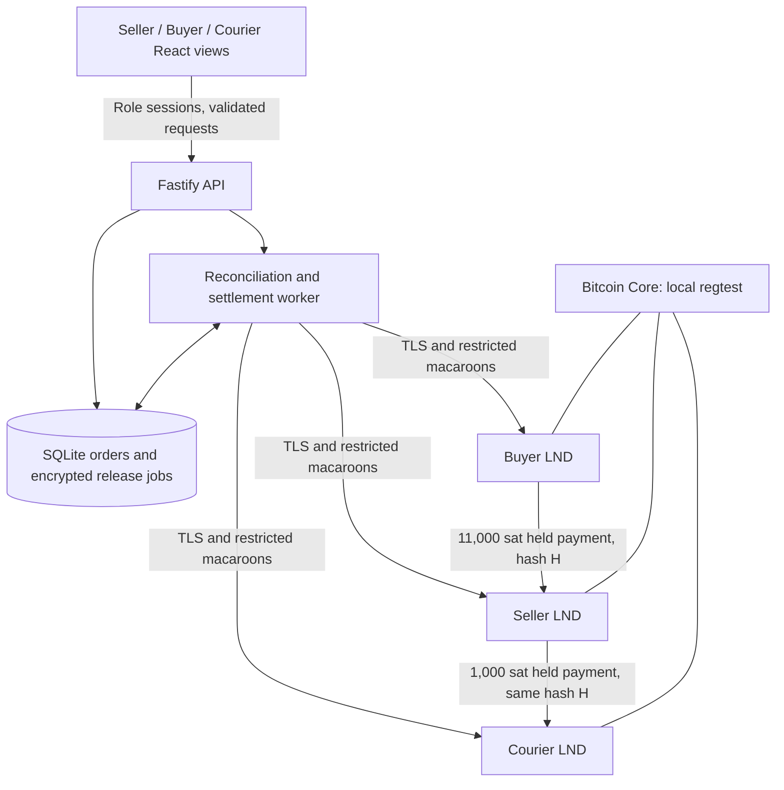

# FlashDrop: Dakar payment on delivery prototype

An English-language, regtest-only Lightning payment flow for a seller, buyer, and courier. The buyer holds the full price before dispatch, inspects the parcel, then authorizes release with a code. The seller's outgoing courier payment uses the same payment hash and reveals the secret needed to settle the seller's incoming payment. This is **payment authorization after inspection**, not cryptographic proof of physical handover.

[Presentation](https://flashdrop-demo.lovable.app/?slide=1) · [GitHub repository](https://github.com/thecosmos42/flashdrop)

## Problem and primary user

FlashDrop is designed for small Dakar merchants selling through social media and using local couriers. Buyers want to inspect goods before releasing payment, sellers want commitment before dispatch. The prototype replaces cash collection at the handover with a held Lightning payment and deliberate buyer authorization. Seller interviews and a field pilot are the next validation step.

## Current status

The app, three-node wallet topology, setup script, and focused tests are implemented. The same-hash chain was confirmed on three real LND regtest nodes. Three consecutive complete API journeys, one complete browser journey using the copy/paste release code, cancellation of held payments, restricted macaroon checks, and restart after a durable release job passed. See [test evidence](docs/test-results.md) for exact results and remaining gates. This software uses fictitious regtest satoshis only. It is not ready for real funds or public deployment.

## Run on Windows

Prerequisites: Docker Desktop with a running Linux engine, Node.js 22 or newer, npm, and PowerShell 5.1 or newer. Reserve several GB for Bitcoin Core and three LND images. First change into this repository folder (`Set-Location -LiteralPath '<full path to dakar-delivery-payments>'`), then run:

```powershell
powershell -ExecutionPolicy Bypass -File scripts/dev.ps1
```

The script starts Bitcoin Core and three LND nodes, mines regtest funds, funds the buyer and seller wallets, opens buyer→seller and seller→courier channels, copies restricted runtime macaroons and TLS certificates into `.runtime`, creates a release encryption key, builds the app, and starts the server at `http://127.0.0.1:3000`. Demo access codes are written to `.runtime/demo-access.json` on first start. Keep that file private. Later runs reuse the volumes, wallet identities, and database. The script mines only when funding or channel confirmations are needed.

Useful commands:

```powershell
powershell -ExecutionPolicy Bypass -File scripts/dev.ps1 status
powershell -ExecutionPolicy Bypass -File scripts/dev.ps1 mine -Blocks 1
powershell -ExecutionPolicy Bypass -File scripts/dev.ps1 down
powershell -ExecutionPolicy Bypass -File scripts/smoke.ps1
node scripts/chain-gate.cjs
npm test
npm run typecheck
```

Run the smoke test only while the app is serving. `down` stops containers without deleting funds or data. Do not delete `.runtime/release.key` while an order may be settling: the backend needs it after restart. Do not publish the app, LND REST ports, database, access codes, or Docker volumes.

## Seed data and testable happy path

The setup script seeds the local Bitcoin network with mined test funds, funds the buyer and seller wallets, opens both Lightning channels, and creates three role access codes. It does not seed real customer information or pre-completed orders. The smoke script creates its own fresh order on each run.

For a manual demo, use this deterministic fixture: **Handmade basket**, quantity **1**, goods **10,000 sat**, delivery **1,000 sat**, total **11,000 sat**. These are fictitious local test funds. Keep the buyer in the same browser profile throughout so its locally stored release secret remains available.

| Role | Action | Expected behavior |
| --- | --- | --- |
| Seller | Sign in using its code from `.runtime/demo-access.json`; create the fixture order | Order appears with total 11,000 sat |
| Buyer | Open the order; select Prepare payment, then Hold 11,000 sat | Buyer payment shows Held |
| Seller | Select Prepare delivery | Courier fee shows Held; order is Ready for pickup |
| Courier | Select Parcel picked up | Order is Out for delivery |
| Buyer | After inspection, show and copy the release code | Buyer deliberately authorizes payment release |
| Courier | Paste the code and select Confirm code | Settling payment changes to Paid; both payment legs succeed |

For a repeatable API check, keep the server running in the first terminal, open a second PowerShell in the repository, and run:

```powershell
powershell -ExecutionPolicy Bypass -File scripts/smoke.ps1
```

Expected output is `PASS: order <id> completed; buyer and courier payments confirmed.` The script checks that the courier fee is held before pickup and both outgoing payments end in `SUCCEEDED`. Complete or cancel any active order before running it. This check exercises real local LND nodes; it is separate from the unit tests. Previously recorded results are in [test evidence](docs/test-results.md); they are not a claim that a new installation has already passed.

## Architecture



Fastify serves the React app and stores order state in SQLite. The worker polls real LND invoice and payment states every two seconds; there is no simulated payment ledger. Buyer secrets are generated with Web Crypto and stored in the buyer browser's IndexedDB. A release job stores the secret encrypted with AES-GCM until both legs settle. A SQLite lease prevents two app workers from operating on the same database.

## Security and trust boundaries

- **Custody:** The demo host controls all three LND wallets and channel funds. This is not trustless escrow. A malicious host could also replace the buyer's web app and steal a future secret.
- **QR meaning:** A valid QR shows only that the buyer disclosed the secret. It cannot prove parcel condition or physical transfer. The courier should request it only after inspection.
- **Expiry:** Invoice expiry limits when a payment can start. Once a hold is accepted, its HTLC block expiry and the 15-minute business deadline govern safety. The worker checks actual LND expiry heights before pickup or release. The browser shows the deadline and whether node observations are fresh.
- **Cancellation:** The worker cancels the courier hold first, then the buyer hold. The UI waits for the senders' terminal failure before showing “Canceled.” A settled payment requires an ordinary refund. If courier settlement wins a cancellation race, the worker settles the buyer leg if possible and flags the order for review.
- **Recovery:** Hash, invoices, send intents, release job, and observed payment states persist in SQLite. An unknown send outcome is looked up by hash before retry. The release key is fingerprinted so a changed key stops startup rather than discarding a pending job.
- **Scope:** One host, three demo roles, short delivery windows, local regtest only. No on-ramp, fiat conversion, Nostr, dispute arbitration, or production wallet interoperability. Arbitrary external wallets have not been tested with held payments.

Role authorization, CSRF and origin checks, strict Zod schemas, a 16 KB request-body limit, and a restrictive content security policy reduce the web attack surface. Request bodies, cookies, CSRF headers, and session cookies are redacted from application logs. Use synthetic order descriptions in the demo; a complete privacy review, including URL and error paths, remains required before claiming that no personal data can reach logs.

The [test evidence](docs/test-results.md) records the completed checks and remaining validation work.

## Repository map

- `apps/server/src/app.ts`: HTTP API, roles, CSRF and origin checks.
- `apps/server/src/flow.ts`: order transitions, reconciliation, cancellation, and recovery.
- `apps/server/src/lightning/lnd.ts`: LND REST adapter with TLS and restricted macaroons.
- `apps/server/src/db.ts`: SQLite schema, sessions, idempotency, and single-instance lease.
- `apps/web/src`: mobile-oriented interface for all three roles, local secret, and QR handling.
- `packages/contracts/src`: shared validation and types.
- `compose.yaml`, `scripts/dev.ps1`: local wallet topology and bootstrap.
- `scripts/smoke.ps1`, `scripts/chain-gate.cjs`: real-node integration checks.
- `tests`: focused logic and API tests with controlled node responses. These alone do not prove wallet integration.
- `docs/test-results.md`: real-node checks and remaining validation work.

## Next iteration and impact measures

Interview Dakar sellers and riders, adjust the workflow from their feedback, and measure merchants reached per week, order completion, time from handover to settlement, cancellations, support cases, and data use on a mid-range phone. A production version would need a clear custody model, wallet compatibility tests, secure mobile delivery of the buyer app, operational monitoring, and a defined refund and on-ramp process.

## Proposed pilot and measurable next iteration

The initial planning target is **10 Dakar merchants × 5 deliveries per merchant per week = 50 weekly orders**. This is a capacity assumption for a proposed pilot, not measured reach or a forecast. Validate the problem with five seller/rider interviews before recruiting merchants.

| Metric | Definition |
| --- | --- |
| Weekly active merchants | Distinct consenting merchants creating an order in seven days |
| Completion rate | Completed orders divided by funded orders, excluding orders still active |
| Settlement latency | Median and p95 time from authorized release to both payments succeeding |
| Cancellations and support | Canceled funded orders and help requests per 100 funded orders |
| Mobile performance | Initial bytes transferred, load time, and successful task completion on a named mid-range phone and throttled connection |
| Reliability | Recovery success after restart, node-outage failures, and orders requiring manual review |

Next we plan to ship clearer deadline and recovery messaging, test the complete journey on separate phones, measure slow-network behavior, and complete the remaining outage, expiry, and privacy checks. We will define ordinary refund handling and test named external wallets before broadening the payment integration. Production custody, secure client delivery, on-ramps, and operational monitoring remain separate release gates.

